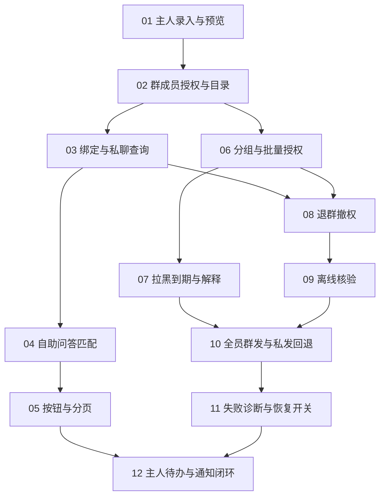

# 账户共享管理拆票清单

状态：已确认并发布。父规格 [#2](https://github.com/xmxxc/QQBotForge/issues/2)；子 Issue #3—#14，12 个父子关系与 14 条原生阻塞关系已核对。

需求来源：[账户共享管理需求规格](../specs/account-sharing.md)。GitHub 仓库：`xmxxc/QQBotForge`。全部票据标记 `ready-for-agent`。连续实施可使用[worker agent 提示词](../prompts/account-sharing-worker.md)。

## 拆分原则

每张票交付一条能演示的业务流程，同时包含必要的数据、接口、命令/页面和行为验证。早期切片先完成主人管理和严格私发，完整群发在成员核验能力之后开放。所有票稿均是未来目标，不表示已安装功能。

| 编号 | GitHub Issue | 票据与交付行为 | 阻塞 Issue |
| --- | --- | --- | --- |
| 01 | [#3](https://github.com/xmxxc/QQBotForge/issues/3) | [主人录入账户并私聊预览](../issue-drafts/account-sharing/01-owner-account-preview.md)：账户管理页、主人命令和按 Bot 持久化闭环 | 无 |
| 02 | [#4](https://github.com/xmxxc/QQBotForge/issues/4) | [指定群成员授权并查看可用账户目录](../issue-drafts/account-sharing/02-group-member-access.md)：白名单、个人/账户权限、基本拒绝与可用目录 | [#3](https://github.com/xmxxc/QQBotForge/issues/3) |
| 03 | [#5](https://github.com/xmxxc/QQBotForge/issues/5) | [授权后绑定身份并完成成员私聊查询](../issue-drafts/account-sharing/03-binding-private-query.md)：主人触发绑定，群/私聊身份关联，真实私发结果 | [#4](https://github.com/xmxxc/QQBotForge/issues/4) |
| 04 | [#6](https://github.com/xmxxc/QQBotForge/issues/6) | [复用自助问答模块完成关键词账户查询](../issue-drafts/account-sharing/04-qa-keyword-query.md)：精确/包含、多关键词、冲突排序、静态回复复用 | [#5](https://github.com/xmxxc/QQBotForge/issues/5) |
| 05 | [#7](https://github.com/xmxxc/QQBotForge/issues/7) | [点击账户按钮直接查询并支持分页](../issue-drafts/account-sharing/05-account-buttons.md)：每账户一按钮、翻页、点击重新鉴权与文字降级 | [#6](https://github.com/xmxxc/QQBotForge/issues/6) |
| 06 | [#8](https://github.com/xmxxc/QQBotForge/issues/8) | [按账户分组和功能授权组批量授权](../issue-drafts/account-sharing/06-bulk-scoped-grants.md)：独立/共享功能范围、单账户/分组/全部、一次/持续授权 | [#4](https://github.com/xmxxc/QQBotForge/issues/4) |
| 07 | [#9](https://github.com/xmxxc/QQBotForge/issues/9) | [按功能范围拉黑、设置到期并解释权限](../issue-drafts/account-sharing/07-deny-expiry-explanation.md)：跨授权来源拒绝优先、实时到期及主人原因查看 | [#8](https://github.com/xmxxc/QQBotForge/issues/8) |
| 08 | [#10](https://github.com/xmxxc/QQBotForge/issues/10) | [退群撤销全部授权来源且重入不恢复](../issue-drafts/account-sharing/08-leave-revocation.md)：模块级事件接线、入群周期与幂等撤权 | [#5](https://github.com/xmxxc/QQBotForge/issues/5), [#8](https://github.com/xmxxc/QQBotForge/issues/8) |
| 09 | [#11](https://github.com/xmxxc/QQBotForge/issues/11) | [离线后暂停资格并由核验恢复](../issue-drafts/account-sharing/09-membership-revalidation.md)：断线/重启/被踢暂停、自动或人工核验、名册完整性 | [#10](https://github.com/xmxxc/QQBotForge/issues/10) |
| 10 | [#12](https://github.com/xmxxc/QQBotForge/issues/12) | [全员含 Bot 合格才群发，否则提示后私发](../issue-drafts/account-sharing/10-all-members-group-delivery.md)：逐账户全员检查和真实发送路径 | [#9](https://github.com/xmxxc/QQBotForge/issues/9), [#11](https://github.com/xmxxc/QQBotForge/issues/11) |
| 11 | [#13](https://github.com/xmxxc/QQBotForge/issues/13) | [群发失败显示逐人原因并可选自动恢复](../issue-drafts/account-sharing/11-group-mode-diagnostics.md)：失败名单、模式说明及主人可选恢复 | [#12](https://github.com/xmxxc/QQBotForge/issues/12) |
| 12 | [#14](https://github.com/xmxxc/QQBotForge/issues/14) | [主人统一处理授权绑定待办并接收结果通知](../issue-drafts/account-sharing/12-owner-workflow-results.md)：继续处理跨入口待办、结果通知、整体演示和使用说明 | [#7](https://github.com/xmxxc/QQBotForge/issues/7), [#13](https://github.com/xmxxc/QQBotForge/issues/13) |

左侧编号是本地切片编号，GitHub Issue 列为实际票号。原有 [Issue #1](https://github.com/xmxxc/QQBotForge/issues/1) 保持独立，不自动关闭或改动。

## 依赖图

初始可开始：01。01 完成后为 02；02 完成后 03、06 可并行。按钮分支不阻塞文字入口的全员群发实现，12 汇合两条业务路径。

## 需求覆盖

| 需求 | 主要负责票 |
| --- | --- |
| R01 管理入口、R02 账户管理、R03 多 Bot、R04 日志机制 | 01，后续各票延续，12 完成管理闭环 |
| R05 默认拒绝、R06 功能范围、R07 资源范围 | 02、06 |
| R08 拒绝优先、R09 期限、R10 可解释 | 02、07、11 |
| R11 新成员不打扰 | 02、08 |
| R12 主人授权触发、R13 身份、R14 私聊群上下文 | 02、03、05 |
| R15 退群撤权、R16 并发顺序 | 08、09、10 |
| R17 离线核验 | 09、12 |
| R18 匹配、R19 多重命中、R20 模块复用 | 04；授权复用由 02、06、08 验证 |
| R21 目录、R22 按钮 | 02、04、05 |
| R23 发送场景、R24 全员含 Bot、R25 资格失效 | 03、09、10 |
| R26 失败名单、R27 恢复开关 | 11 |
| R28 私发失败 | 03、05、10 |
| R29 拒绝提示、R30 主人通知 | 02、03、11、12 |

## 已确认的测试边界

主要通过真实业务入口验证：注入 QQ 文字、按钮或生命周期事件，或请求已鉴权/未鉴权管理 API，观察资格状态、真实临时持久化和目标消息。仅替换平台事件来源、成员/发送接口和时间，不读取真实凭据，不向真实群发账密。

每张票包含自己的行为验证，不把所有测试推迟到最后，也不单独拆成数据库/API/页面横向票。平台实际许可不足时验证降级路径，完整名册不可核验就不开放群发。

## 发布结果

- 父规格 #2 使用完整需求正文，#3—#14 为原生子 Issue。
- 每张票正文列出实际阻塞 Issue，并已设置 GitHub 原生阻塞关系。
- 已补建并应用 `ready-for-agent` 标签。
- 父子 Issue 链接已回填本文、需求规格和逐张票稿。
- 本轮交付需求规格与实施票据，功能实现另行安排。
