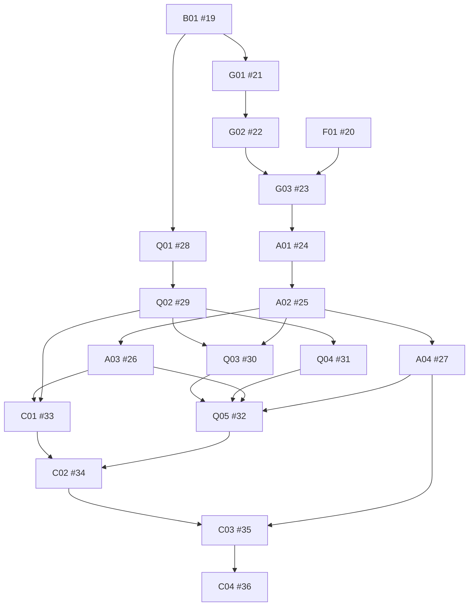

# 三模块与账户共享实施清单

状态：2026-10-20 用户确认并发布。父规格 [#18](https://github.com/xmxxc/QQBotForge/issues/18)；18 张子票，24 条真实技术阻塞边。新票全部待实施／迁移验收，标签为 `ready-for-agent`；受阻票需先满足依赖。

规格：[总体规格](../specs/bot-modules.md)与[账户业务规则](../specs/account-sharing.md)。实现现状见[进度](account-sharing-progress.md)，接入约定见[模块接入](account-sharing-extension-boundary.md)。

## 实施票据

| 编号 | Issue | 可独立验收的交付 | 分支 | 真实阻塞 |
| --- | --- | --- | --- | --- |
| B01 | [#19](https://github.com/xmxxc/QQBotForge/issues/19) | 基础：解除存储安装耦合并验证现有数据兼容 | personal | 无 |
| F01 | [#20](https://github.com/xmxxc/QQBotForge/issues/20) | 框架：核对并验收群事件、连接及本地恢复公开契约 | main | 无 |
| G01 | [#21](https://github.com/xmxxc/QQBotForge/issues/21) | 群状态：独立查看和刷新已知群及 Bot 状态 | personal | [#19](https://github.com/xmxxc/QQBotForge/issues/19) |
| G02 | [#22](https://github.com/xmxxc/QQBotForge/issues/22) | 群状态：核验分页名册、成员角色和完整性 | personal | [#21](https://github.com/xmxxc/QQBotForge/issues/21) |
| G03 | [#23](https://github.com/xmxxc/QQBotForge/issues/23) | 群状态：接入生命周期和断线恢复并发布可信变化 | personal | [#22](https://github.com/xmxxc/QQBotForge/issues/22)、[#20](https://github.com/xmxxc/QQBotForge/issues/20) |
| A01 | [#24](https://github.com/xmxxc/QQBotForge/issues/24) | 授权：独立管理群成员策略并实现消费方隔离 | personal | [#23](https://github.com/xmxxc/QQBotForge/issues/23) |
| A02 | [#25](https://github.com/xmxxc/QQBotForge/issues/25) | 授权：完成范围批量、期限、拒绝和权限解释 | personal | [#24](https://github.com/xmxxc/QQBotForge/issues/24) |
| A03 | [#26](https://github.com/xmxxc/QQBotForge/issues/26) | 授权：通用身份绑定与私聊群上下文 | personal | [#25](https://github.com/xmxxc/QQBotForge/issues/25) |
| A04 | [#27](https://github.com/xmxxc/QQBotForge/issues/27) | 授权：提供全员资格报告及发送前有效性检查 | personal | [#25](https://github.com/xmxxc/QQBotForge/issues/25) |
| Q01 | [#28](https://github.com/xmxxc/QQBotForge/issues/28) | 问答：独立配置并使用公开文字问答 | personal | [#19](https://github.com/xmxxc/QQBotForge/issues/19) |
| Q02 | [#29](https://github.com/xmxxc/QQBotForge/issues/29) | 问答：正则、统一排序和多答案选择 | personal | [#28](https://github.com/xmxxc/QQBotForge/issues/28) |
| Q03 | [#30](https://github.com/xmxxc/QQBotForge/issues/30) | 问答：逐规则权限与按群委托管理 | personal | [#29](https://github.com/xmxxc/QQBotForge/issues/29)、[#25](https://github.com/xmxxc/QQBotForge/issues/25) |
| Q04 | [#31](https://github.com/xmxxc/QQBotForge/issues/31) | 问答：图文、Markdown 与交互按钮组合回复 | personal | [#29](https://github.com/xmxxc/QQBotForge/issues/29) |
| Q05 | [#32](https://github.com/xmxxc/QQBotForge/issues/32) | 问答：受限群回复转私发及跨群身份复用 | personal | [#30](https://github.com/xmxxc/QQBotForge/issues/30)、[#31](https://github.com/xmxxc/QQBotForge/issues/31)、[#26](https://github.com/xmxxc/QQBotForge/issues/26)、[#27](https://github.com/xmxxc/QQBotForge/issues/27) |
| C01 | [#33](https://github.com/xmxxc/QQBotForge/issues/33) | 账户共享：迁移为独立模块的组合消费者 | personal | [#26](https://github.com/xmxxc/QQBotForge/issues/26)、[#29](https://github.com/xmxxc/QQBotForge/issues/29) |
| C02 | [#34](https://github.com/xmxxc/QQBotForge/issues/34) | 账户共享：统一关键词、目录、按钮与私聊查询 | personal | [#33](https://github.com/xmxxc/QQBotForge/issues/33)、[#32](https://github.com/xmxxc/QQBotForge/issues/32) |
| C03 | [#35](https://github.com/xmxxc/QQBotForge/issues/35) | 账户共享：严格全员群发、逐人诊断及恢复设置 | personal | [#34](https://github.com/xmxxc/QQBotForge/issues/34)、[#27](https://github.com/xmxxc/QQBotForge/issues/27) |
| C04 | [#36](https://github.com/xmxxc/QQBotForge/issues/36) | 账户共享：主人待办通知与三模块整体使用验收 | personal | [#35](https://github.com/xmxxc/QQBotForge/issues/35) |

执行优先级为基础与框架核对 → 群状态 → 授权 → 问答 → 账户共享。依赖边只表示真实技术阻塞：公开问答独立性使 Q01 仅依赖 B01，不为了排序而强行依赖授权。用户期望的交付顺序仍按群状态、授权、问答、账户共享安排。

B01 是兼容迁移的先行票；F01 可以独立核对已有框架交付。每票包含真实入口、持久化、管理体验及行为验证，不按数据库／页面横向拆分。原有代码尽量迁移复用，完成需满足新票全部验收。

## 依赖图

## 需求覆盖

| 规格要求 | 负责票 |
| --- | --- |
| 上游调研、安装解耦、旧数据兼容 | B01 |
| 框架公开契约及真实接线版本证据 | F01 |
| G01—G02、G08 独立状态入口 | G01 |
| G03、G05 名册与角色完整性 | G02 |
| G04、G06—G07 生命周期／恢复／订阅 | G03 |
| A01—A04、A06、A08—A09 基本策略与隔离 | A01、A02 |
| A05 通用绑定与群上下文 | A03 |
| A07 全员检查与最终凭据 | A04 |
| Q01—Q02 独立公开问答 | Q01 |
| Q03—Q04 排序／正则／候选 | Q02 |
| Q06—Q07 逐规则权限／委托 | Q03 |
| Q05 图文／按钮／降级 | Q04 |
| Q08—Q09 受限路由／消费者复用 | Q05、C01 |
| R01—R04、R20 账户管理／隔离／迁移 | C01，B01、A01 |
| R05—R17 准入／范围／绑定／退群／核验 | A01—A03，G02—G03，C02 |
| R18—R22 匹配／目录／按钮 | Q02，C02 |
| R23—R28 群私路由／全员／诊断／恢复 | A04，Q05，C02—C03 |
| R29—R30 提示／主人待办和通知 | C02、C04 |

## 原票承接

| 原票 | 新票承接 | 处理 |
| --- | --- | --- |
| [#2](https://github.com/xmxxc/QQBotForge/issues/2) | [新父规格 #18](https://github.com/xmxxc/QQBotForge/issues/18) | 以规划替代关闭，保留原实现与讨论 |
| [#4](https://github.com/xmxxc/QQBotForge/issues/4) | [#24](https://github.com/xmxxc/QQBotForge/issues/24)、[#34](https://github.com/xmxxc/QQBotForge/issues/34) | 以规划替代关闭，保留原实现与讨论 |
| [#5](https://github.com/xmxxc/QQBotForge/issues/5) | [#26](https://github.com/xmxxc/QQBotForge/issues/26)、[#34](https://github.com/xmxxc/QQBotForge/issues/34) | 以规划替代关闭，保留原实现与讨论 |
| [#6](https://github.com/xmxxc/QQBotForge/issues/6) | [#28](https://github.com/xmxxc/QQBotForge/issues/28)、[#29](https://github.com/xmxxc/QQBotForge/issues/29)、[#30](https://github.com/xmxxc/QQBotForge/issues/30)、[#34](https://github.com/xmxxc/QQBotForge/issues/34) | 以规划替代关闭，保留原实现与讨论 |
| [#7](https://github.com/xmxxc/QQBotForge/issues/7) | [#29](https://github.com/xmxxc/QQBotForge/issues/29)、[#31](https://github.com/xmxxc/QQBotForge/issues/31)、[#34](https://github.com/xmxxc/QQBotForge/issues/34) | 以规划替代关闭，保留原实现与讨论 |
| [#8](https://github.com/xmxxc/QQBotForge/issues/8) | [#25](https://github.com/xmxxc/QQBotForge/issues/25)、[#33](https://github.com/xmxxc/QQBotForge/issues/33) | 以规划替代关闭，保留原实现与讨论 |
| [#9](https://github.com/xmxxc/QQBotForge/issues/9) | [#25](https://github.com/xmxxc/QQBotForge/issues/25)、[#27](https://github.com/xmxxc/QQBotForge/issues/27) | 以规划替代关闭，保留原实现与讨论 |
| [#10](https://github.com/xmxxc/QQBotForge/issues/10) | [#23](https://github.com/xmxxc/QQBotForge/issues/23)、[#24](https://github.com/xmxxc/QQBotForge/issues/24) | 以规划替代关闭，保留原实现与讨论 |
| [#11](https://github.com/xmxxc/QQBotForge/issues/11) | [#22](https://github.com/xmxxc/QQBotForge/issues/22)、[#23](https://github.com/xmxxc/QQBotForge/issues/23)、[#24](https://github.com/xmxxc/QQBotForge/issues/24) | 以规划替代关闭，保留原实现与讨论 |
| [#12](https://github.com/xmxxc/QQBotForge/issues/12) | [#27](https://github.com/xmxxc/QQBotForge/issues/27)、[#32](https://github.com/xmxxc/QQBotForge/issues/32)、[#35](https://github.com/xmxxc/QQBotForge/issues/35) | 以规划替代关闭，保留原实现与讨论 |
| [#13](https://github.com/xmxxc/QQBotForge/issues/13) | [#35](https://github.com/xmxxc/QQBotForge/issues/35) | 以规划替代关闭，保留原实现与讨论 |
| [#14](https://github.com/xmxxc/QQBotForge/issues/14) | [#36](https://github.com/xmxxc/QQBotForge/issues/36) | 以规划替代关闭，保留原实现与讨论 |
| [#16](https://github.com/xmxxc/QQBotForge/issues/16) | [#20](https://github.com/xmxxc/QQBotForge/issues/20)、[#23](https://github.com/xmxxc/QQBotForge/issues/23) | 以规划替代关闭，保留原实现与讨论 |
| [#17](https://github.com/xmxxc/QQBotForge/issues/17) | [#19](https://github.com/xmxxc/QQBotForge/issues/19)、[#24](https://github.com/xmxxc/QQBotForge/issues/24)、[#25](https://github.com/xmxxc/QQBotForge/issues/25) | 以规划替代关闭，保留原实现与讨论 |

原 #3 保留已完成状态，作为主人 CRUD／预览回归基础；#1 的独立修复状态保持不变。原票关闭表示规划被替代，不表示原业务验收通过。原生旧父子关系与讨论保留作历史记录，新执行只遵循本清单与新父规格。

## 验收边界

从真实模块管理、HTTP／QQ 管理、文字／按钮和框架原始事件入口验证最终状态和消息。使用临时数据库、假身份、平台替身和可控时间；分别报告独立安装、算法、实际接入、浏览器与真实平台许可证据。部署及真实数据迁移另行安排。
