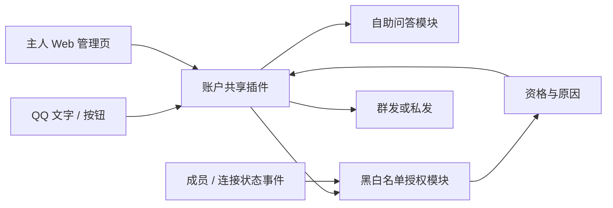

# 账户共享管理需求规格

状态：业务需求、测试边界与 12 张实施票拆分已确认。日期：2026-10-17。

GitHub 父规格：[#2](https://github.com/xmxxc/QQBotForge/issues/2)；12 张实施子票已发布，关联及依赖已核对。

本规格描述目标行为，不表示功能已经实现。实施跟踪见[拆票清单](../plans/account-sharing-tickets.md)。

2026-10-18 实施范围：框架源码保持不变，继续完成三个扩展内可独立实现和验证的部分。依赖 #16 事件与连接接口的生产接入、通知及整体验收保留未完成；管理端核验和模拟事件测试不能作为该接入已完成的证据。

## Problem Statement

主人希望在指定 QQ 群中共享账户的账号、密码，但加入白名单群不代表自动获得使用资格。只有主人授权的成员才能查询，退群后必须失去该群内的授权，重新入群不能自动恢复。

主人需要通过 Web 页面和机器人命令管理账户、规则、授权和黑名单。成员应能点击账户按钮直接查询，不必记住复杂命令。群内公开发送账密时，必须确认当前全群成员，包括 Bot，都有该账户的调用及查看资格；不能满足时转为私发。

这些能力需要拆成两个可复用模块和一个业务插件，供以后开发其他功能时复用。

## Solution

### 1. 总体结构与术语

| 部分 | 职责 | 不负责的业务 |
| --- | --- | --- |
| 黑白名单授权模块 | 群准入、个人授权、功能授权组、资源授权、黑名单、到期、成员状态、退群撤权、资格解释 | 保存和修改共享账户的密码 |
| 自助问答模块 | 规则管理、精确与包含匹配、多关键词、优先级、去重和歧义结果；提供静态文字回复能力 | 自行认定调用者有账户权限，或修改实际账户密码 |
| 账户共享插件 | 账户管理，组合前两个模块，身份绑定流程、列表按钮、查询、发送路径和主人管理页面 | 维护一套绕过授权模块的独立授权名单 |

- **主人**：机器人命令使用当前 Bot 的 `owner_ids`；Web 管理沿用现有面板管理员会话。框架按单一主人管理使用，普通 QQ 成员没有后台管理权限。
- **功能作用域**：某个插件或明确注册的功能。默认不同插件的授权互不相通。
- **功能授权组**：主人明确选择的一组功能，可一次授予多个功能；“全部功能”也是一个明确选择的作用域。它不同于账户分组。
- **账户分组**：对共享账户的分类，用于目录和资源授权。
- **授权主体**：当前 Bot、当前群、当前群成员的组合。私聊身份关联到这个主体后，仍然受对应群的授权约束。
- **绑定**：建立经过验证的群身份与私聊身份关联，不等于授予查询权限。
- **待核验**：保留授权记录，但成员状态无法确认，暂不允许查询。
- **群发资格**：针对一个 Bot、一个群、一个账户计算，全员均有调用及查看资格，并且成员名单已核验。

### 2. 主人管理与账户资源

**R01 管理入口。** 同时支持主人机器人命令和 Web 扩展管理页，使用同一份数据和业务规则。管理命令可由主人在群里或私聊发起；查看详细失败名单、绑定资料等管理结果只提供给主人。群内可给简短状态，详情通过主人私聊或已登录后台查看。

**R02 账户管理。** 支持账户新增、编辑、启停、删除、分组和批量操作。每条账户至少包含稳定标识、显示名称、账号、密码、启用状态；说明和使用地址可选。修改密码后，下次查询读取当前值。停用立即停止查询；删除账户时移除其查询入口及对该账户的直接授权，不让同名新账户继承旧授权。

**R03 多 Bot 隔离。** 账户、规则、群名单、功能授权组、授权、黑名单、绑定、待处理流程和通知均按 AppID 隔离。任何“全部”都不跨 Bot。模块在进程中共享实例不代表业务数据共享。

**R04 存储与日志。** 使用框架现有持久化和日志机制。主人可从现有后台和日志查看业务信息，包括框架记录的消息正文。管理页说明现有记录行为，不宣称密码回复不会被记录。记录授权变更、核验、拒绝、绑定和发送结果，便于主人追查。

### 3. 群准入、授权和拒绝

**R05 默认拒绝。** 群不在功能适用的白名单中，或成员没有对应授权时，不允许查询。群白名单只是准入条件，不能代替成员授权。

**R06 授权范围。** 默认按单个功能精细授权；支持功能授权组及全部功能的快捷授权。范围必须由主人明确选择，不因一个插件使用了模块就自动共享授权。私聊查询也不绕过群准入。

**R07 资源范围。** 功能调用资格和账户资源资格同时满足才能查询。资源可以选择单个账户、账户分组或全部账户。一次批量授权只覆盖当前选中的资源；持续授权覆盖明确选择的当前及未来资源。两者在界面和命令中明确区分。

**R08 拒绝优先。** 框架已经拒绝的请求不能被新模块重新放行。模块适用的群/成员黑名单及功能范围黑名单优先于所有正向授权，包括功能授权组、全部功能、资源分组和持续授权。管理者需先解除适用的拒绝，重新批量授权不能覆盖拉黑。

**R09 有效期。** 授权默认长期有效，也可指定到期时间。批量操作可统一设置；到期立即失去使用资格，不依赖定时清理是否已经运行。已有按钮同样受影响。

**R10 可解释性。** 授权模块返回是否允许、具体原因、授权来源及所用成员核验状态。主人能查看“为什么可用/不可用”，能区分无功能授权、无账户授权、拉黑、到期、退群、待绑定和待核验。绑定问题只阻止需要该身份映射的操作，不能把缺少私聊绑定一概当作群内无资格。

### 4. 加群、绑定和退群

**R11 入群不打扰。** 新成员进入白名单群时，不自动授权、不私聊、不邀请绑定。只更新成员状态、使旧的全员检查结果失效并重新判断群发资格。成员离开后重入作为新的入群周期处理。

**R12 主人授权触发流程。** 主人在任一管理入口指定授权后，保存授权并报告结果。有经过验证的身份关联时复用；没有时进入待绑定流程，按平台能力尝试联系或在当前群给出绑定引导，再把处理结果反馈给主人。授权成功、绑定成功、通知成功和密码发送成功分别记录，授权操作本身不自动发送密码。

**R13 身份正确性。** 不假定数字 QQ 号等于 OpenID，不假定群成员、私聊、union 标识相同，也不假定跨群或跨 Bot 标识相同。群内优先支持主人 @目标成员；私聊和 Web 可从该 Bot 已识别成员及待绑定申请中选择。引用消息定位目标仅在实际载荷能明确识别作者时使用。直接输入标识须明确类型和所属群，不能靠字符串相同自动绑定。自动绑定必须有可靠平台依据或经过验证的双场景身份关联；否则交由主人确认。

**R14 私聊群上下文。** 私聊查询必须解析到仍有效的群授权主体。只有一个可用群时自动选择；有多个时展示用户有资格使用的群供选择。切换群后重新计算账户列表。没有已绑定且可核验的群资格时，不返回账户信息。

**R15 退群撤权。** 收到成员主动退群或被移出事件后，由授权模块撤销该成员在该群的使用资格，覆盖直接授权、功能授权组、全部功能和资源持续授权。其他群的独立授权保留。重新加入后必须由主人重新授权，旧授权组成员关系和旧按钮不能使其恢复。黑名单保留。

**R16 幂等与事件顺序。** 退群、重入、重复事件、重试和并发查询不能使旧授权复活。以群原生成员身份和可追踪的入群周期处理生命周期事件，不能依赖消息显示身份的 union 切换结果。状态变更先影响资格判断，再完成异步持久化；查询发送前检查资格版本，避免已知状态改变后继续按旧结果发送。

**R17 离线和核验。** 重启、不能确认事件连续性的断线、机器人被移出群等情况使相关成员资格进入待核验；不把网络失败或无接口权限当成确认退群。能够可靠查询时自动核验，不能时由主人核对后单独或批量恢复。核验只恢复尚有效且未撤销的授权，不复活已退群撤销、已到期或被拉黑的授权。单个成员的人工核验不能自动证明全群名册完整。

### 5. 自助问答与账户查询

**R18 匹配方式。** 每条规则支持精确匹配、包含匹配；多个关键词可对应同一回复或同一账户。默认精确匹配。规则和关键词可启停，按 Bot、消费插件的命名空间隔离。

**R19 多重命中。** 精确优先于包含；包含规则按主人设置的优先级排序，未设置按较长关键词优先；仍然并列时让用户在有权访问的候选中选择。同一账户被多个关键词命中只返回一次。不向无权访问的用户展示候选名称。普通聊天未命中时不回应。

**R20 模块复用。** 自助问答提供规则匹配结果和静态回复能力；账户共享通过匹配结果引用账户，并在实际读取和发送前使用授权模块校验。匹配模块不内置账户存储或账户权限。预留由调用插件解释匹配结果的边界，不在首版执行自动改密等外部动作。

**R21 目录与直接查询。** 支持文字命令、账户关键词和账户目录。目录只显示当前用户在当前群上下文有权使用的账户；停用、删除及不满足资格的账户不显示。

**R22 按钮。** 优先使用消息按钮：通用“账户列表”入口、每账户一个按钮、分页和必要的群选择按钮。点击账户按钮直接查询。按钮携带账户或查询会话的引用，点击后读取最新账户。个人菜单绑定调用者、Bot 及群上下文；他人点击不能获得原调用者的身份。文字、指令按钮、回调按钮共用查询流程并在每次操作时重新鉴权；交互 ACK 不代表业务成功。按钮能力不可用时提供等价的文字入口。

### 6. 发送路径与全员检查

**R23 按查询场景发送。** 私聊查询始终私发。群内查询仅在主人已开启该账户在该群的群发、且当前群发资格满足时公开发送。群发不合格时，群里先提示将尝试私发，再向查询者私发账密；提示不附带账密，也不提前声称发送成功。

**R24 全员资格。** 针对当前账户检查完整群成员集合，包含本 Bot 和其他 Bot，不自动排除任何成员。每个成员都必须有功能调用及该账户查看资格；群准入、拒绝、期限和成员状态仍适用。不能以“所有已记录的人通过”冒充“全群通过”，也不能仅凭人数相等推断名单完整。

**R25 新成员与资格失效。** 新人未授权、任一成员被拉黑/撤权/到期、名单未核验完整或检查期间发生已知成员变化时，不再满足群发条件，实际发送改为私发。各账户分别判断；一个账户满足条件不能替其他账户通过检查。

**R26 切换失败报告。** 主人尝试启用群发时检查资格；失败保持实际私发，向主人展示账户、已确认不能使用的成员及逐人原因。可用名称辅助显示，但身份标识为准，不伪造真实 QQ 号。把“明确不合格”和“名单尚不完整/无法核验”分开显示；没有完整名单时不宣称列出了全部失败成员。提供相应管理入口，但不允许强制忽略失败发送。

**R27 恢复设置。** “满足条件后自动恢复群发”按群和账户配置，由主人选择，默认关闭。关闭时条件恢复只通知主人，由主人手动切换；开启时重新核验满足条件后恢复实际群发模式。主人主动关闭群发时清除恢复意向，不能被自动恢复开关重新打开。模式恢复本身不主动发送账密。保留目标模式和实际模式，界面能说明为何当前处于私发。

**R28 私发失败。** 缺少可靠私聊身份、好友关系、平台许可或发送失败时报告真实状态并引导处理；不能把群成员 OpenID 直接当作私聊 ID 使用。私发失败不取消已保存的授权，不转为公开发送，也不向主人或群声称已送达。

### 7. 反馈和默认值

**R29 拒绝提示。** 命中入口、关键词或按钮但没有使用权限时，统一简短提示“你暂无此功能的使用权限，请联系主人”。对同一用户短时间重复提示限频，不展示账户或其他人的授权情况，不为每次未授权尝试私聊主人。后台保留原因。

**R30 主人通知。** 对主人发起的授权、绑定、核验和群发切换流程报告处理结果，能关联原操作，区分成功、部分成功、待处理和发送失败。批量操作给汇总及逐项详情，重复事件不重复通知。无法私聊主人时在已登录后台保留结果，当前群只给简短提示。通知不自动附带账密。

| 设置 | 默认值 |
| --- | --- |
| 群准入 | 白名单，未配置即拒绝 |
| 新成员 | 未授权，不联系 |
| 功能授权范围 | 单功能独立授权 |
| 资源授权 | 明确选中的账户；扩展范围需主人选择 |
| 授权有效期 | 长期，可指定到期时间 |
| 匹配方式 | 精确匹配 |
| 群发 | 关闭，实际私发 |
| 自动恢复群发 | 关闭 |
| 名册或成员状态不明确 | 暂停相关查询或转为私发，取决于不明确的是查询者资格还是全员群发资格 |
| 私发失败 | 反馈失败及绑定引导，保持账密未公开 |

## User Stories

1. 作为主人，我希望通过已登录的 Web 页面录入账户，以便不用编辑配置文件。
2. 作为主人，我希望通过机器人命令管理，以便在 QQ 中完成快捷操作。
3. 作为主人，我希望编辑密码后查询立即读取新值，以便维护共享账户。
4. 作为主人，我希望停用或删除账户后旧按钮失效，以便停止分享。
5. 作为主人，我希望账户按分组管理，以便批量授权。
6. 作为主人，我希望只允许指定群使用，以便限制服务范围。
7. 作为主人，我希望入群不会自动授权，以便由我决定使用者。
8. 作为主人，我希望授权具体群里的具体成员，以便不同群独立管理。
9. 作为主人，我希望从 @成员和已识别身份中选人，以便准确指定授权对象。
10. 作为主人，我希望区分授权完成和绑定待处理，以便知道用户是否已经可以查询。
11. 作为主人，我希望单独授权一个功能，以便保持插件权限独立。
12. 作为主人，我希望通过功能授权组批量授权，以便减少重复操作。
13. 作为主人，我希望明确选择全部功能，以便统一授权而不影响其他 Bot。
14. 作为主人，我希望限制到单账户、分组或全部账户，以便精细控制资源。
15. 作为主人，我希望区分一次批量与持续授权，以便决定未来新增账户是否可查。
16. 作为主人，我希望设置授权到期时间，以便临时开放。
17. 作为主人，我希望黑名单压过正向授权，以便可靠停用权限。
18. 作为主人，我希望查看允许或拒绝的依据，以便排查配置。
19. 作为成员，我希望只有主人授权后才进入绑定流程，以便入群时不被打扰。
20. 作为成员，我希望完成身份绑定后私聊查询，以便方便获取账户。
21. 作为成员，我希望在多个授权群之间选择上下文，以便使用正确的账户范围。
22. 作为成员，我希望发送关键词直接查询，以便不必记住账户编号。
23. 作为成员，我希望点击账户列表，以便发现自己可用的账户。
24. 作为成员，我希望每个账户就是一个可点击按钮，以便一步获取账密。
25. 作为成员，我希望通过分页浏览，以便账户多时仍能使用。
26. 作为成员，我希望在按钮不可用时仍能文字查询，以便不受客户端能力影响。
27. 作为主人，我希望同一账户配置多个关键词，以便兼容不同叫法。
28. 作为主人，我希望规则冲突有明确顺序，以便不会意外返回多个密码。
29. 作为主人，我希望退群自动取消该群全部授权来源，以便离群成员停止查询。
30. 作为主人，我希望重新入群仍需重新授权，以便旧权限不会自动复活。
31. 作为主人，我希望离线后不能核验的成员暂停使用，以便不依赖过期状态。
32. 作为主人，我希望可以批量核验恢复，以便处理机器人重启后的待办。
33. 作为主人，我希望机器人被移出群时冻结该群资格，以便不能继续用私聊绕过群状态。
34. 作为主人，我希望群发前全群包含 Bot 都通过检查，以便符合全员可调用和查看的规则。
35. 作为主人，我希望新人未授权时立即停止依赖旧的群发资格，以便新状态影响后续查询。
36. 作为主人，我希望群发启用失败列出不合格成员及原因，以便自行处理授权。
37. 作为主人，我希望能决定是否自动恢复群发，以便掌握发送方式。
38. 作为成员，我希望群发不合格时收到私发，以便仍能使用自己的授权。
39. 作为成员，我希望私发失败时收到准确提示，以便知道还需要什么操作。
40. 作为主人，我希望批量操作显示部分成功和待处理项，以便继续完成流程。
41. 作为插件开发者，我希望复用授权模块，以便新功能不重复实现黑白名单和退群撤权。
42. 作为插件开发者，我希望复用问答匹配模块，以便新功能沿用相同规则能力。
43. 作为主人，我希望不同 Bot 的账户及权限独立，以便增加 Bot 不会自动共享数据。
44. 作为未授权成员，我希望看到简短明确的提示，以便知道需要联系主人。

## Implementation Decisions

1. 两个模块提供可独立调用的接口，账户插件组合它们。账户数据归业务插件；授权模块只认识通用功能和资源引用；问答模块只返回规则及回复/资源引用，不持有账户密码。
2. 授权判断的输入必须明确 Bot、功能、群、群成员、资源及动作；结果提供允许/拒绝、原因、来源、成员核验状态和版本。文字、按钮、API 执行同一业务规则。
3. 功能授权组描述功能集合，账户分组描述资源集合，避免同名“分组”混用。直接、一次批量、持续授权均保留来源，便于解释和撤销。
4. 持久化采用项目现有 SQLite 能力保存有关系和并发变更的数据，简单设置可沿用模块配置能力；读写必须按 AppID 分区。数据库版本及升级在实现票中随行为一起交付。
5. 授权记录、入群周期、核验状态、身份映射和发送结果分别保存。拥有一条授权记录不等于当前可用，也不等于可以私发。
6. 通过最小、通用的事件接线使授权模块接收成员和连接状态；撤权由模块执行，不能仅依赖账户插件的普通消息拦截器。事件接线兼容现有插件；模块不可用时依赖它的查询停止。
7. 当前模块已有生命周期和实例获取能力，但没有现成的接收消息/成员事件 Hook。成员处理和消息查询有并发，不能依赖先写入历史成员表再读出的假设。采用状态版本、入群周期和幂等处理，发送前重新检查已知变更。
8. 私聊映射保留原生群成员标识、私聊标识及可靠来源；启用 union 身份显示时仍能用退群事件的群原生标识定位授权主体。
9. Web 利用现有扩展页面与自定义鉴权路由，无需重建已编译的主前端。新增管理 API 必须验证现有面板会话；Bot 命令校验相应 Bot 的主人身份，回调不能仅靠装饰器或按钮客户端权限。
10. 问答匹配先生成候选，再由消费插件按当前权限筛选、去重和完成查询。静态问答的准入策略由消费插件明确选择，模块不自动监听并回复所有聊天。
11. 群发检查使用完整分页名册和本轮变更状态，而不是本地活跃用户缓存。刷新失败、分页中断、成员变更冲突、无接口权限或完整性未知时不通过群发检查。每次实际群发前重新核验；恢复设置不能绕过这一步。
12. 群发目标模式、实际模式和恢复开关分开；群发资格按账户计算。开启失败或资格丢失后保持实际私发，界面显示原因和恢复意向。
13. 消息按钮优先使用可用的回调能力，单独完成 ACK 和业务发送。引用对象、翻页和个人菜单均重新验证调用者和上下文。平台拒绝按钮时使用文字操作，不影响权限判断。
14. 主人通知与普通成员拒绝提示分别处理；持久化操作结果可在后台恢复查看，发送失败不回滚已经成功的授权。
15. 本仓库已经存在的插件文件禁用问题由 [Issue #1](https://github.com/xmxxc/QQBotForge/issues/1) 跟踪。本需求的账户启停和权限撤销必须在业务入口生效，不以 UI 显示“插件未启用”作为唯一保障；不把该缺陷默认为已修复。

## Testing Decisions

主要验收边界是“真实业务入口收到文字、按钮或管理请求，到资格变更及实际发送结果”。使用真实模块、查询流程和临时 SQLite，替换 QQ 事件来源、平台成员/消息接口及时间；不读取本机真实凭据，也不向真实群发送测试账密。

Web 测试通过真实的已鉴权/未鉴权 HTTP 请求进入扩展接口，验证持久化和后续 QQ 行为，而不是仅检查页面按钮。规则排序等可做少量稳定的公开接口单元测试，不针对内部表结构、私有函数调用次数或页面标签写镜像测试。

测试基础为项目已声明的 pytest、pytest-asyncio 和异步配置；目前没有现成测试套件可直接照搬。第一次业务切片建立最小可复用测试宿主，后续切片复用，不先建设独立测试框架。

必须覆盖以下外部行为：

| 验收场景 | 期望结果 |
| --- | --- |
| 群不在白名单/成员无授权/无资源权限 | 不返回账户信息，给限频拒绝提示 |
| 拉黑与全部功能/持续授权同时存在 | 拒绝优先 |
| 一次批量授权后新增账户 | 新账户不自动可查 |
| 持续授权范围内新增账户 | 符合其他条件时可查 |
| 到期、账户停用或删除后点击旧按钮 | 不能获取旧内容 |
| 群身份与私聊身份不同/union 设置变化 | 正确关联，不误绑、不漏撤权 |
| 离开群 A，同时保留群 B 授权 | A 不可用，B 独立可用 |
| 退群、重入、重复/延迟事件及并发查询 | 不复活旧授权；已知撤权后的查询被拦截 |
| 重启/无法确认恢复的断线/机器人被移出群 | 相关资格暂停；人工或可靠自动核验后恢复有效部分 |
| 两个有相同账户名/规则名的 Bot | 数据、按钮、授权及通知互不串用 |
| 精确、包含、长短关键词、优先级、同账户重复命中 | 按规则确定结果，歧义时只给有权候选 |
| 他人点击个人菜单、伪造上下文、回调绕过普通拦截器 | 真实点击者必须重新通过业务鉴权 |
| 完整名单中某个 Bot 无权限 | 群发失败，主人看到该成员及原因 |
| 仅本地成员全部通过/分页缺失/群人数已知但身份不全 | 不认定全群通过，保持私发 |
| 检查期间收到新人/撤权/到期 | 原群发决策失效，重新判断或转私发 |
| 群内查询不能群发，私发成功/失败两种情况 | 群只收到真实状态提示，账密不作为失败回退公开 |
| 自动恢复关闭/开启/主人主动关闭群发 | 分别等待手动、核验后恢复、保持关闭；不主动推送密码 |
| 未登录管理 API/非主人管理命令 | 拒绝管理操作 |
| 授权成功但通知失败 | 授权保留，后台展示待处理或通知失败 |
| 按钮能力被平台拒绝 | 等价文字查询仍可用 |

真实平台能力仅做单独、受控的集成核查：记录按钮、成员查询及私聊许可是否可用。平台不具备能力时验收降级路径，不伪造成功，也不把这些能力当作所有机器人必然具备。

## Out of Scope

- 自动修改外部账户密码、账户登录代操作、占用租借、排队和归还。
- 语义或错别字近似匹配、正则规则、外部动作执行系统。
- 多主人租户隔离、不同后台管理员权限、跨 Bot 自动共享账户或权限。
- 把真实数字 QQ 号通用转换成任意场景 OpenID。
- 绕过成员或按钮 API 的平台许可；无法核验时强制公开账密。
- 使已经发送给用户的密码在退群后自动失效；首版撤权阻止的是后续查询。

## Further Notes

### 平台能力与保证范围

1. 框架有按钮构建、交互事件、主动私发及群成员查询封装，不代表当前 Bot 获得了所有平台权限。
2. 官方按钮文档列有模板申请与自定义按钮开通条件；框架存在示例，但本需求尚未实测用户 Bot 的按钮能力。
3. 群成员分页接口目前为内邀/白名单能力；本地活跃成员不是完整群名册。无法获得可核验完整名单时，全员群发功能保持不可用，已核验的个人仍可私聊查询。
4. 平台没有已证的“成员查询与发送原子快照”保证。实现只能针对本轮核验及已收到的事件作出判断，检测到冲突就停止群发；不能承诺在平台尚未投递入群/退群事件时已知晓变更。文档和界面不得宣称绝对实时或零遗漏。
5. 群按钮点击后的普通回复会发回群。私发须主动选择经过绑定的私聊目标，交互 ACK 不能替代私发消息。
6. 私聊可能因无好友关系、拒收或平台限制失败。错误状态必须保留且可解释。

### 官方参考

- [消息按钮](https://bot.q.qq.com/wiki/develop/api-v2/server-inter/message/trans/msg-btn.html)
- [群 @消息及身份结构](https://bot.q.qq.com/wiki/develop/api-v2/autogen/event/group_at_message_create.html)
- [发送单聊消息](https://bot.q.qq.com/wiki/develop/api-v2/autogen/api/v2_users_user_openid_messages.post.html)
- [群成员分页查询](https://bot.q.qq.com/wiki/develop/api-v2/autogen/api/v2_groups_group_openid_members.get.html)
- [单个群成员查询](https://bot.q.qq.com/wiki/develop/api-v2/autogen/api/v2_groups_group_openid_members_member_openid.get.html)
- [群成员移出事件](https://bot.q.qq.com/wiki/develop/api-v2/autogen/event/group_member_remove.html)
- [机器人被移出群事件](https://bot.q.qq.com/wiki/develop/api-v2/autogen/event/group_del_robot.html)

## 补充实施约束（2026-10-17）

交付仅安装自助问答、授权两个模块及账户共享一个插件，框架源码保持不变。存储位于扩展目录，通过现有上下文数据路径接入。退群撤权、连接连续性等能力若缺少可靠扩展接口，必须说明接口、方案及限制，等待用户选择；不得自行修改框架或将未实现能力标记完成。此约束优先于前文允许随票修改通用框架接口的实施假设。

当前接口检查及待选方案见 [扩展接入检查](../plans/account-sharing-extension-boundary.md)。成员敏感查询在可靠接入确定前暂停。

用户已确认保留完整可靠性保证，接口前置优化记录于 [Issue #16](https://github.com/xmxxc/QQBotForge/issues/16)，等待下一轮评审与排期。当前不修改框架，不恢复未验收的成员敏感查询。
