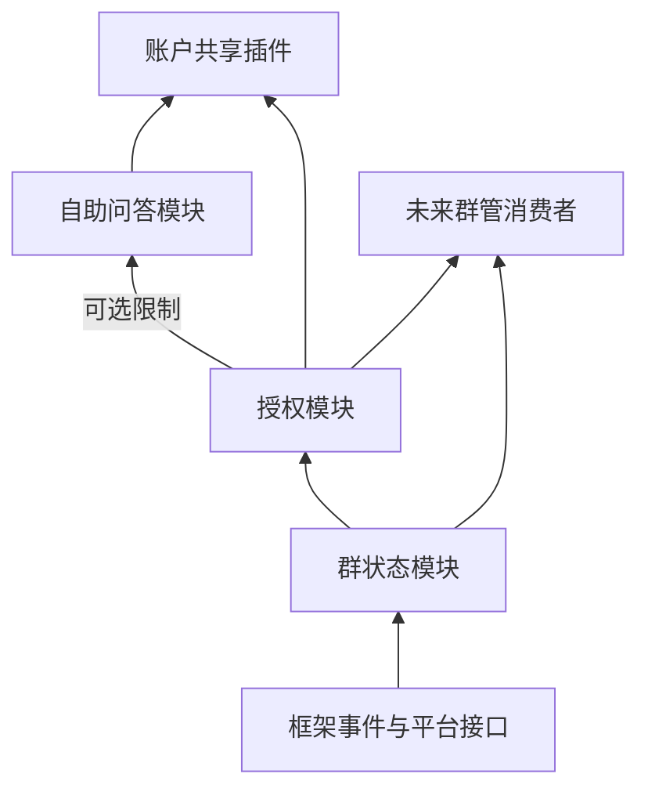

# 群状态、授权、自助问答与账户共享规格

状态：2026-10-20 用户确认；实施与验收按 GitHub 新票据推进。本文描述目标行为，当前实现状态见[实施进度](../plans/account-sharing-progress.md)，票据见[实施清单](../plans/bot-modules-tickets.md)。

## Problem Statement

主人希望分别使用群状态、授权和自助问答三个模块，再通过账户共享插件组合这些能力。现有实现主要围绕账户共享提供入口，问答安装依赖授权目录，成员状态、身份绑定和全员检查分散在授权及账户代码中，普通问答尚不能独立配置使用。

需要让每个模块有清楚的职责、可独立验证的使用路径和稳定的消费接口。保留已实现的账户管理与业务规则，逐步迁移，按实际证据验收。

## Solution

### 职责与依赖

| 交付 | 职责 | 独立使用方式 |
| --- | --- | --- |
| 群状态模块 | 群、成员、角色、Bot 平台能力、变化事实、完整性与可信状态 | 独立启停；主人查看与刷新状态；其他模块查询和订阅 |
| 授权模块 | 准入、角色策略、明确授权、拒绝、期限、身份绑定、成员周期撤权、资格解释、全员资格检查 | 独立管理授权；消费者查询当前决定及失效原因 |
| 自助问答模块 | 规则管理、消息入口、匹配、候选选择、回复；受限规则复用授权 | 单独安装即可配置公开问答；按需接入授权 |
| 账户共享插件 | 账户与密码、账户目录、账户专属管理与发送策略 | 组合问答和授权；账户管理仅主人可用 |

箭头表示提供能力。群状态只提供事实；授权结合事实与策略作决定。群状态不依赖上层消费者，授权不依赖问答、账户或未来群管消费者。普通公开问答不要求安装或启用群状态、授权。群主／管理员委托管理及受限问答需要授权；涉及群事实的判断再由授权使用群状态。

### G：完整群状态模块

- **G01 独立交付。** 支持发现、启停、重载、持久化、主人管理入口、稳定消费接口及说明。所有事实按 Bot 分区；展示名不能代替原生身份。
- **G02 群概览。** 展示已知群、来源、更新时间、Bot 在群状态及可用的平台能力。平台未提供完整群列表时明确显示“已知群”，不能把历史记录称为所有群。
- **G03 成员名册。** 提供分页成员读取、单成员核验、角色及 Bot 自身状态。名册记录完整性、核验时间、错误与版本；中断、冲突、重复游标、缺页、缺少已知成员和无许可均不能形成完整证明。不能只凭人数相等或活跃用户缓存证明完整。
- **G04 变化事实。** 接收成员加入／退出、Bot 加入／移出，并按平台实际能力跟踪角色变化。没有事件覆盖时通过可靠核验刷新，返回能力限制，不假造角色变更事件。保留原生 Bot／群／成员、事件来源及可用的时间、标识与顺序信息。
- **G05 状态可信性。** 区分历史、待核验、当前可靠核验、完整性未知、状态冲突与不支持。查询失败、空值和无权限不等于成员已离开。已知变化使相关快照和在途判断失效。
- **G06 连续性。** 使用框架受支持的生命周期、连接事实与本地恢复契约。首次启动、重启、新会话、未知连续性、处理失败或缺口需可靠重建基线；收到 READY／RESUMED 本身不能恢复信任。确认更新完成后才承认处理完成，不重复通过两套订阅应用同一事件。
- **G07 消费接口。** 对外提供状态快照、核验／刷新、变化通知、能力发现和版本检查。订阅结果区分成功、失败、超时和卸载；迟到回调、重载及持久化延迟不能恢复旧信任。平台不支持的来源明确返回能力边界。
- **G08 主人体验。** 已登录后台和主人命令可以查看、刷新、定位错误；普通成员不能枚举名册或管理状态。人工确认一个成员只形成该成员的有来源事实，不证明全群完整。群状态保存事实与核验依据，不保存功能授权或共享密码。

### A：通用授权模块

- **A01 独立策略。** 主人身份、群主／管理员角色、群准入、成员、功能、资源、期限和拒绝是明确的策略条件。角色检查读取群状态；角色不会自动获得账户管理权或账户查看权。
- **A02 默认与覆盖。** 消费方明确选择公开、指定群／成员、角色或细粒度授权策略。规则可继承默认策略或单独配置；公开只表示无需个人正向授权，不扩展框架或主人启用范围。适用的框架拒绝和模块明确拒绝始终优先。
- **A03 授权范围。** 按 Bot、消费方、功能、群、成员及资源隔离。保留单功能／功能授权组／全部功能，单资源／资源组／全部资源，一次快照／持续授权、来源撤销、批量逐项结果和实时到期。任何“全部”都不跨 Bot。
- **A04 资格解释。** 统一返回允许／拒绝、原因、适用来源、成员核验状态、版本和有效期；发送前可验证决定仍然有效。公开策略不强迫执行与其无关的群成员连续性检查；依赖群资格的操作则要求可信群事实。
- **A05 绑定与上下文。** 管理通用群成员与私聊身份的可靠关联和待审申请，不用 QQ 号、union 标识或字符串相等推断绑定。可靠平台依据或主人核实后确认。群限定私聊需当前群资格；多个可用群可选择。绑定不等于授权，未涉及群资格的公开私聊无需绑定。
- **A06 生命周期。** 依据群状态事实使授权失效。退群撤销该成员在该群的全部明确授权来源；重入需主人重新授权；其他群及黑名单保留。角色派生策略按当前角色重算，不能通过角色变化恢复已撤销的明确账户授权。新成员只维护事实，不自动授权、私聊或邀请绑定。
- **A07 全员检查。** 对指定功能／资源／动作返回全员资格报告及发送前验证凭据，包含本 Bot 和其他 Bot。名册与角色完整性由群状态提供，授权不要求插件解析平台响应或内部状态。受限问答检查所有接收者查看权；账户共享另要求全员调用和查看权。
- **A08 隔离与恢复。** 消费方标识稳定并检查冲突，资源所有权明确。区分局部业务／存储错误、共享群事实失效、整体存储故障及模块停用；局部失败不无谓影响无关 Bot／消费方。恢复需重新建立可信状态；共同故障仍使实际依赖方拒绝。
- **A09 独立管理。** 主人可通过后台与命令管理策略、授权、绑定、核验和解释，使用同一业务规则；消费方可以嵌入对应管理能力。支持普通问答委托策略，但账户管理固定为主人。

### Q：独立自助问答模块

- **Q01 开箱使用。** 单独安装、启用即可由主人通过页面／命令配置规则并接收群聊、私聊文字；无需账户插件或授权目录。明确配置 Bot、群及私聊启用范围；普通聊天未命中不回应，沿用框架接收与 @ 策略。
- **Q02 规则。** 按 Bot 和消费方隔离；支持全局及分群、增删改、规则与关键词启停、多个关键词对应同一回复、默认精确匹配、包含及正则。规则或内容更新后旧候选重新检查。
- **Q03 排序。** 先筛除无权查看的候选，再去重排序。精确优先于包含，包含优先于正则；同类可设置优先级，包含未设置时较长关键词优先。全局和本群规则共同参与，不自动遮盖全局规则。并列最佳答案展示有权标题及按钮／文字选项，不泄漏无权候选名称。
- **Q04 正则。** 保存时校验并提供测试反馈；明确匹配资源限制，复杂模式或执行超限不能拖住事件循环和其他 Bot。非法规则不替换现有有效配置；此项作为匹配行为验收，不预设具体执行库。
- **Q05 回复。** 支持文字、图片、Markdown、按钮及组合。按钮支持答案选择、翻页、查询指令和打开链接，引用规则／会话而不携带敏感答案；回调校验真实调用者和当前资格。平台不支持时使用明确的文字／链接降级；ACK 与回复成功分开记录。
- **Q06 默认与逐条权限。** 公开问答无需授权模块；受限规则和角色委托复用授权，不维护另一套成员名单。缺少授权依赖只暂停受影响的受限规则／管理操作，公开问答可继续；模块失效不能使受限内容变成公开。
- **Q07 委托管理。** 默认只有主人管理规则；主人可按群允许当前群主／管理员管理本群规则。他们不能修改全局、其他群、授权策略、自己的委托或账户配置；角色或委托撤销后旧管理请求重新检查。普通成员无后台会话；委托者通过群命令管理。
- **Q08 发送范围。** 公开群问答直接群内回复。受限群问答仅在完整全员查看资格通过时群发，否则只在群内给状态并私发提问者。提问者自身资格不明先拒绝，不能靠改为私发绕过。私聊群限定问答复用绑定与群选择。缺少绑定或发送失败时给处理引导，不回退公开答案。
- **Q09 开发者复用。** 同一匹配核心可返回规则和回复／资源引用供消费者解释，也提供独立问答入口；账户数据与账户发送策略不进入匹配核心。消费者决定自身入口与效果，账户路径不被普通问答入口重复消费。

### C：账户共享组合

详细业务规则保持在[账户共享规格](account-sharing.md)。账户插件复用问答匹配、授权及身份上下文，不直接获取平台名册或复制全员资格算法。仅主人管理；指定群准入不代表成员授权。私聊私发；群内只有主人启用该群／账户群发、全员含 Bot 均有调用和查看资格时群发，否则提示后私发。目标模式、实际模式及默认关闭的自动恢复分开记录。所有入口读取最新账密并在发送前重新检查。

### 上游复用与迁移

优先检查[插件市场](https://github.com/ElainaCore/Elaina-plugins)、[关键词回复](https://github.com/miaolik/plugin-gjc)及[群管实现](https://github.com/lengxi-root/elaina-plugins-lengxi/tree/main/groupguard)。记录固定提交、适合复用的行为／接口、兼容性和许可条件，再决定直接依赖、提取或参考实现；市场描述不构成功能已验收证据。

现有账户、规则、授权来源、期限、拒绝、成员周期、绑定及待办需要迁移验证。先解除存储对授权业务包的安装依赖，再迁移成员事实、通用绑定和全员资格检查；保持旧数据可读、稳定 ID、拒绝优先和已撤权不复活。备份与迁移使用临时副本验证，生产数据变更单独安排。

## User Stories

1. 作为主人，我希望单独启用群状态模块，以便查看 Bot 已知的群。
2. 作为主人，我希望知道群列表来源和范围，以便区分已知群与完整列表。
3. 作为主人，我希望分页查看成员，以便核对真实名册。
4. 作为主人，我希望看到成员角色，以便配置群管理资格。
5. 作为主人，我希望查看 Bot 平台能力，以便知道哪些操作可执行。
6. 作为主人，我希望刷新失败保留错误和历史标识，以便不误认成员退群。
7. 作为消费者开发者，我希望订阅原生成员变化，以便及时撤销依赖的资格。
8. 作为消费者开发者，我希望查询可信版本，以便让旧结果失效。
9. 作为主人，我希望重启后看到待核验状态，以便避免把旧记录当成当前事实。
10. 作为主人，我希望可靠恢复和补发处理有证据，以便决定何时恢复使用。
11. 作为主人，我希望独立管理授权，以便多个插件使用同一机制。
12. 作为主人，我希望分别授权群、成员、功能和资源，以便精细控制。
13. 作为主人，我希望一次和持续授权分开，以便控制未来新增资源。
14. 作为主人，我希望拒绝优先，以便重新授权不会解除黑名单。
15. 作为主人，我希望权限实时到期，以便旧按钮不能延长资格。
16. 作为主人，我希望看到权限原因，以便处理配置错误。
17. 作为主人，我希望核实群与私聊身份后绑定，以便正确私发。
18. 作为成员，我希望选择有效授权群，以便私聊使用正确上下文。
19. 作为主人，我希望退群撤权、重入重新授权，以便旧来源不复活。
20. 作为消费者开发者，我希望不同消费方与 Bot 隔离，以便局部错误不扩散。
21. 作为消费者开发者，我希望取得全员资格报告，以便不复制名册与权限算法。
22. 作为主人，我希望单独安装问答即可使用，以便不用安装账户共享。
23. 作为主人，我希望通过后台和命令维护问答，以便不用编辑数据库。
24. 作为主人，我希望一个答案对应多个关键词，以便减少重复维护。
25. 作为主人，我希望支持精确、包含和正则，以便表达不同触发条件。
26. 作为主人，我希望保存前验证正则，以便错误规则不影响其他回复。
27. 作为用户，我希望并列答案可点击选择，以便找到目标内容。
28. 作为用户，我希望看不到无权候选，以便权限保护覆盖菜单。
29. 作为主人，我希望规则可全局或分群配置，以便复用公共信息。
30. 作为主人，我希望公开规则独立运行，以便授权模块停用时公开帮助仍可用。
31. 作为主人，我希望逐条限制群、成员和角色，以便区分公开与内部资料。
32. 作为主人，我希望按群委托管理员，以便他们维护本群规则。
33. 作为主人，我希望委托不影响全局或账户管理，以便权限职责明确。
34. 作为用户，我希望收到图文和按钮回复，以便方便阅读和操作。
35. 作为用户，我希望平台不支持按钮时有文字入口，以便继续查询。
36. 作为主人，我希望群内受限答案检查所有接收者，以便未授权成员看不到内容。
37. 作为用户，我希望群内不适合公开时收到私发，以便继续获取有权答案。
38. 作为用户，我希望私发失败得到准确提示，以便完成绑定或调整关系。
39. 作为主人，我希望账户插件复用三个模块，以便以后维护通用能力只改一处。
40. 作为主人，我希望旧数据经验证迁移，以便已有授权和账户继续可管理。
41. 作为主人，我希望进度区分算法、实际接入和真实平台核查，以便知道完成程度。
42. 作为未来群管开发者，我希望读取群状态并检查授权，以便复用能力且不形成循环依赖。

## Implementation Decisions

1. 群状态拥有成员事实、名册证明、角色和来源连续性；授权拥有策略、授权来源、绑定和资格；问答拥有普通问答应用入口与匹配；账户插件拥有账户业务。
2. 接口暴露版本化事实、资格和原因，不要求消费者读取其他模块内部存储或平台响应。依赖缺失按实际功能范围报告。
3. 可独立分发是安装与运行契约：公开问答不能通过存储导入隐式要求授权。沿用现有上下文数据路径与标准 SQLite 能力，通用存储复用方式在兼容迁移票内决定，不增加必装业务模块。
4. 读取和写入均按 Bot、消费方及资源所有权隔离。标识冲突可检测；权限范围共享必须由主人明确选择。
5. 事实更新、策略更新、会话／规则失效先使判断失效，发送前复查版本与时间。框架事件使用公开契约，更新完成与恢复确认有可追踪关系。
6. 通用框架接口由 main 维护；扩展及其业务测试、文档由 personal 维护；框架变更单独提交及 PR，再同步供扩展消费。
7. 当前群生命周期与连接接口已有交付；本地恢复机制亦已有实现。先核对精确版本与接线证据，补充缺口，再让群状态接入；不能通过手工打开能力标记替代验收。
8. 管理页复用既有扩展路由与会话鉴权，QQ 管理校验当前 Bot 的真实操作者。普通群角色委托不发放后台登录权限。

## Testing Decisions

主要边界为真实模块加载、已鉴权／未鉴权管理请求、QQ 文字与按钮、框架原生事件入口，到临时持久化及最终目标消息。沿用现有业务宿主和框架事件接线测试方式，仅替换平台传输、成员／发送接口与时间。

每张票验证自己的可演示行为。覆盖群状态单独安装、授权独立消费、问答单独公开使用、问答加授权、完整账户组合；验证不安装上层模块时底层可运行。覆盖多 Bot、多消费方、失效顺序、断线／重载、名册不完整、角色撤销、迁移和故障影响范围。

直接调用策略或人工触发模拟 Hook 仅证明算法；框架真实接线、恢复屏障与发送前检查必须分别有入口证据。使用假身份、假账密和临时数据库，不读取实际凭据、修改运行实例或连接真实 QQ。浏览器和真实平台许可核查若未执行，单独标明。

## Out of Scope

欢迎、入群答题、审核、踢人、禁言等群管动作；语音、视频、定时推送；自动改密等外部动作；语义近似匹配；多后台管理员租户。未来消费者可以复用本次模块接口扩展这些能力。

## Further Notes

完整性和连续性保证针对当前进程已知事件及可靠核验，不承诺平台未投递事件、无限离线补发、跨进程连续性或查询与发送原子快照。普通问答的“公开”与账户共享的默认拒绝分别定义，不能互相覆盖。

2026-10-20 审计基于 personal 的 3509cd9 及当时工作区：账户共享业务自 61dfff0 后未修改；86 项业务测试通过，仍主要使用模拟观察源。群状态模块尚未建立，授权未接入已存在的框架新接口；新规格的独立模块与集成验收保持待完成。
